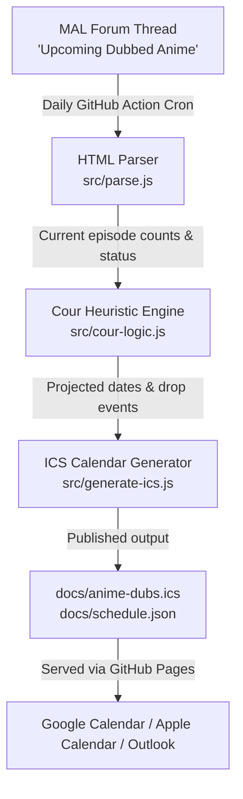

<div align="center">

# 📅 Anime Dub Calendar

**Automated, intelligent weekly English anime dub release schedule feed.**  
Syncs episode premiere dates directly to your Google Calendar, Apple Calendar, or Outlook.

[](https://github.com/fizzyfrys/anime-dub-calendar/actions/workflows/build.yml)
[](https://fizzyfrys.github.io/anime-dub-calendar/)
[](https://fizzyfrys.github.io/anime-dub-calendar/anime-dubs.ics)
[](https://github.com/fizzyfrys/anime-dub-calendar/actions)
[](LICENSE)

<br/>

### 🌟 [👉 Open Live Web App & Schedule Viewer 👈](https://fizzyfrys.github.io/anime-dub-calendar/)

<br/>

<!-- Subscription Buttons -->
<p align="center">
  <a href="https://calendar.google.com/calendar/render?cid=webcal%3A%2F%2Ffizzyfrys.github.io%2Fanime-dub-calendar%2Fanime-dubs.ics">
    
  </a>
  &nbsp;
  <a href="webcal://fizzyfrys.github.io/anime-dub-calendar/anime-dubs.ics">
    
  </a>
  &nbsp;
  <a href="https://fizzyfrys.github.io/anime-dub-calendar/anime-dubs.ics">
    
  </a>
</p>

</div>

---

## ⚡ Quick Subscription Feeds

Choose your preferred format:

### 1. 🏷️ Standard Feed (`Title - Ep ##`) — *Default*
*Ideal for desktop calendar views and clean list overviews.*
- **Google Calendar**: [📅 Add Standard Feed](https://calendar.google.com/calendar/render?cid=webcal%3A%2F%2Ffizzyfrys.github.io%2Fanime-dub-calendar%2Fanime-dubs.ics)
- **Apple Calendar / Webcal**: [🍎 Subscribe via Webcal](webcal://fizzyfrys.github.io/anime-dub-calendar/anime-dubs.ics)
- **Raw URL**: `https://fizzyfrys.github.io/anime-dub-calendar/anime-dubs.ics`

### 2. 📱 Compact Feed (`Ep ## · Title`) — *Mobile & Widget Friendly*
*Guarantees episode numbers are always visible upfront without getting truncated by long anime titles.*
- **Google Calendar**: [📅 Add Compact Feed](https://calendar.google.com/calendar/render?cid=webcal%3A%2F%2Ffizzyfrys.github.io%2Fanime-dub-calendar%2Fanime-dubs-ep-first.ics)
- **Apple Calendar / Webcal**: [🍎 Subscribe via Webcal](webcal://fizzyfrys.github.io/anime-dub-calendar/anime-dubs-ep-first.ics)
- **Raw URL**: `https://fizzyfrys.github.io/anime-dub-calendar/anime-dubs-ep-first.ics`

---

## ✨ Features

- 🔄 **Fully Automated**: Runs every morning via GitHub Actions using the MyAnimeList forum and English Dubbed calendar.
- ⏰ **Local Release Times**: Published times appear in your calendar's time zone. Dates without a published time stay all-day.
- 🧠 **Cour-Aware Prediction Engine**: Automatically projects upcoming episode release dates for standard 12-episode (1 cour) and 24-episode (2 cour) broadcasts.
- 📦 **Multi-Episode Drop Detection**: Detects unannounced mid-season double/multi-episode drops and schedules them on the exact drop date.
- 🎯 **Deterministic Event UIDs**: Uses RFC 5545 compliant deterministic event IDs (`mal-dub-<slug>-ep-<n>@anime-dub-cal`) so calendar clients update existing events without duplicates.
- 🧹 **Dynamic Auto-Pruning**: When a show ends or is removed from the schedule, extra projected events are automatically purged upon the next calendar poll.
- 🌐 **Zero Server Maintenance**: Pure static hosting on GitHub Pages with GitHub Actions automation.

---

## 🛠️ How It Works



---

## 📐 Cour Projection Heuristics

Anime broadcast schedules frequently list unknown totals (`??`). This pipeline uses domain-aware cour heuristics:

| Current Progress | Inferred Total | Projected Episodes | Sync Lifecycle |
|---|---|---|---|
| `8/12` (Known total) | Exact (`12`) | Episodes 9–12 on broadcast weekday | Fixed projection |
| `8/??` (Unknown, `< 12`) | **1-Cour (12 eps)** | Episodes 9–12 | Adjusts if total updates |
| `13/??` (Boundary `12–13`) | **+2 buffer** | Episodes 14–15 | Rolling window while awaiting confirmation |
| `19/??` (Between `13–24`) | **2-Cour (24 eps)** | Episodes 20–24 | Adjusts to finale when confirmed |
| `24/??` (Boundary `24–25`) | **+2 buffer** | Episodes 25–26 | Rolling window for split-cour |
| `118/???` (Long-running) | Continuous | +4 weeks rolling ahead | Ongoing weekly projection |
| `**` (*Suspended*) | Frozen | No future projections | Marked in event description |
| `++` (*Resumes Date*) | Scheduled | Projections anchor to resume date | Resume date reflected on calendar |
| **Multi-Episode Drop** | Jump `> 1` within 7 days | Extra episodes placed on drop day | Emits separate events on same date |

---

## 🚀 Setup & Subscription Guide

### Google Calendar
1. Click the **[Subscribe in Google Calendar](https://calendar.google.com/calendar/render?cid=webcal%3A%2F%2Ffizzyfrys.github.io%2Fanime-dub-calendar%2Fanime-dubs.ics)** button above.
2. When Google Calendar opens, click **Add**.
3. Google Calendar will poll for updates automatically (typically every 8–24 hours).

*Manual Method:*
1. Open [Google Calendar](https://calendar.google.com) on desktop.
2. In the left sidebar, click **+** next to **Other calendars** → **From URL**.
3. Paste: `https://fizzyfrys.github.io/anime-dub-calendar/anime-dubs.ics`
4. Click **Add calendar**.

---

### Apple Calendar (iPhone, iPad, Mac)
1. Tap/click **[Subscribe via Webcal](webcal://fizzyfrys.github.io/anime-dub-calendar/anime-dubs.ics)**.
2. Calendar will open with a prompt to subscribe.
3. Choose your refresh frequency (e.g., **Every Day**) and click **Subscribe**.

---

### Microsoft Outlook
1. Open Outlook Calendar → **Add Calendar** → **Subscribe from web**.
2. Paste: `https://fizzyfrys.github.io/anime-dub-calendar/anime-dubs.ics`
3. Enter name (e.g. `Anime Dubs`) and click **Import**.

---

## 🐳 Self-Host on Unraid

The container serves the site and both feeds on port `8080`. It refreshes on startup and daily at **10:00 UTC**, using MAL and English Dubbed. It keeps the previous files if the main build fails and uses cached release times and exclusions if English Dubbed is unavailable. By default it does not publish to GitHub.

In Unraid, choose **Docker → Add Container** and use these settings:

| Setting | Value |
|---|---|
| Name | `anime-dub-calendar` |
| Repository | `ghcr.io/fizzyfrys/anime-dub-calendar:latest` |
| Network Type | Bridge |
| Port | Container `8080` → any free host port, such as `8080` |
| Path | Host `/mnt/user/appdata/anime-dub-calendar` → container `/data` (read/write) |
| Extra Parameters | `--user 99:100` |

Enable **Autostart** for the container and ensure the mapped host directory is writable by Unraid's `nobody:users` (`99:100`), or use the UID and GID that own your directory in `--user`. Open `http://<unraid-ip>:8080/` to find both feeds. Google Calendar cannot fetch a private LAN address; use the public feed for Google Calendar unless your self-hosted URL is reachable from Google.

The [container workflow](https://github.com/fizzyfrys/anime-dub-calendar/actions/workflows/container.yml) publishes the image after the Docker changes merge. If the package is private, authenticate to GHCR with a `read:packages` token, or [make the package public](https://docs.github.com/en/packages/learn-github-packages/configuring-a-packages-access-control-and-visibility) for anonymous pulls.

If you have a local image archive, use the Unraid terminal instead of pulling from a registry:

```sh
docker load -i anime-dub-calendar-amd64.tar.gz
docker run -d --name anime-dub-calendar --restart unless-stopped \
  --user 99:100 -p 8080:8080 \
  -v /mnt/user/appdata/anime-dub-calendar:/data \
  anime-dub-calendar:unraid
```

If English Dubbed returns HTTP 403 from the Unraid host too, the container logs a warning and continues with MAL and any cached data. To use an authorized local copy of the calendar instead, save it in the mapped directory and set `DUB_CALENDAR_HTML_PATH=/data/english-dubbed.html` in the container. Update the snapshot manually, or remove the variable to resume live fetches.

### Keep GitHub Pages in sync

Unraid can serve the calendar locally and publish the same generated files to `main:/docs` after each successful refresh. The [public calendar URL](https://fizzyfrys.github.io/anime-dub-calendar/) and both subscription URLs stay the same. No internet-facing port is needed.

1. Create a [fine-grained personal access token](https://github.com/settings/personal-access-tokens/new) for **only** `anime-dub-calendar`, with repository **Contents: Read and write**, using the GitHub account that owns the Pages site. Save it outside the `/data` host directory in a file readable only by the container user (`99:100` in the example, file mode `600`). Mount that file read-only at `/run/secrets/github-publish-token`. Do not put the token in the repository or a Docker environment variable.
2. In [Actions variables](https://github.com/fizzyfrys/anime-dub-calendar/settings/variables/actions), set `CALENDAR_PUBLISHER` to `unraid` so the GitHub-hosted build no longer overwrites the generated feeds. Let any running daily build finish before enabling Unraid publishing.
3. Set `GITHUB_PUBLISH_REPOSITORY=fizzyfrys/anime-dub-calendar` and `GITHUB_PUBLISH_TOKEN_FILE=/run/secrets/github-publish-token` in the container. Restart it and check the logs for `Published feeds to`. The [Pages deployment](https://github.com/fizzyfrys/anime-dub-calendar/actions/workflows/pages/pages-build-deployment) is separate and can take a few minutes.

If Unraid is offline or cannot push to GitHub, Pages keeps the last published feeds. A GitHub publish failure does not affect the local feeds. To hand publishing back to GitHub Actions, remove the two publishing environment variables from the container first, then remove `CALENDAR_PUBLISHER` from the repository and run [Build Anime Dub Calendar](https://github.com/fizzyfrys/anime-dub-calendar/actions/workflows/build.yml).

---

## 💻 Local Development

```bash
# 1. Clone repo
git clone https://github.com/fizzyfrys/anime-dub-calendar.git
cd anime-dub-calendar

# 2. Install dependencies
npm install

# 3. Run tests
npm test -- --runInBand

# 4. Build from both live sources
npm run build

# Or use saved HTML snapshots and leave published files untouched
node src/index.js --local mal.html --dub-calendar english-dubbed.html --output-dir /tmp/anime-dub-build
```

---

## 📚 Data Source & Disclaimer

- [MyAnimeList "Upcoming Dubbed Anime"](https://myanimelist.net/forum/?topicid=1692966) provides the baseline schedule, episode counts, and hiatuses. Later episode dates are estimates, even for shows with a known episode count.
- The [English Dubbed Anime Calendar](https://english-dubbed.com/anime-industry/english-dub-anime-calendar/) supplies published release times and additional episodes. Entries are matched by normalized title (with aliases for verified alternate names) and episode number. A conflicting confirmed MAL premiere date or hiatus takes precedence.
- Shows known to be on OceanVeil or only on YouTube are excluded from both feeds and the website. Shows without platform information still use MAL. If English Dubbed is unreachable, the build uses cached times and exclusions alongside the MAL schedule.
- The daily workflow adds a warning annotation and job summary if English Dubbed cannot be fetched, yields zero usable releases, or yields less than half as many as its last healthy run. It keeps publishing MAL and cached data without resetting that baseline.
- This project is independent and is not affiliated with either source.
